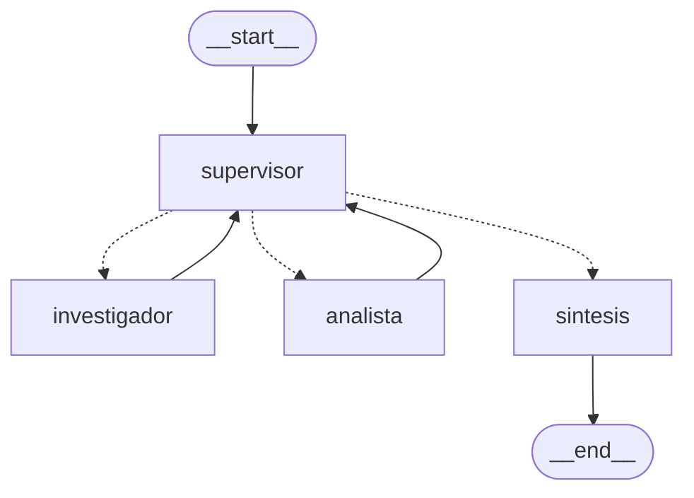

# Orquestador multi-agente de análisis e investigación

Un supervisor reparte cada pregunta entre dos especialistas y, cuando los dos cumplieron, un nodo de síntesis redacta la respuesta. El `investigador` busca en las políticas internas de TechCorp. El `analista` calcula con una calculadora que no usa `eval`. Los especialistas no se hablan entre sí: cada uno vuelve al supervisor.

El estado (`state.py`) hereda de `MessagesState` y suma un campo `contribuciones`. El reducer es `operator.add`: cada nodo agrega la suya y no pisa las anteriores. Así queda quién aportó qué.

Corrida real (`python main.py`, `gpt-4o-mini`):

```text
Nodo: supervisor
   next_agent: investigador
Nodo: investigador
   [investigador] Primeros 5 años: 14 días. De 5 a 10 años: 21 días. Después de 10 años: 28 días.
Nodo: supervisor
   next_agent: analista
Nodo: analista
   [analista] El total acumulado es de 231 días.
Nodo: supervisor
   next_agent: FINISH
Nodo: sintesis
   [supervisor] 5×14 = 70, 5×21 = 105, 2×28 = 56. Total: 231 días.
```

La pregunta nombra dos dominios. El monto de cada tramo sale de la política de vacaciones y el total sale de la calculadora: `5*14 + 5*21 + 2*28 = 231`.

## Cómo se cumple cada requerimiento


| Requerimiento                            | Cómo se cumple                                                                                                                                                                                                                                 | Evidencia                                                                                                                                        |
| ---------------------------------------- | ---------------------------------------------------------------------------------------------------------------------------------------------------------------------------------------------------------------------------------------------- | ------------------------------------------------------------------------------------------------------------------------------------------------ |
| **Topología jerárquica**                 | `nodo_supervisor` decide con `with_structured_output(DecisionSupervisor)`. `enrutar` devuelve `Literal["investigador", "analista", "sintesis"]` y esa es la arista condicional. `FINISH` no termina: va a `sintesis`, y `sintesis` va a `END`. | `graph.py` · [Topología](#topología-del-grafo) · `test_topologia`                                                                                |
| **Agente de investigación**              | `agente_investigador = create_agent(...)` con una sola herramienta, `buscar_en_politicas_internas`, sobre el RAG híbrido de las políticas.                                                                                                     | `agents/research_agent.py` · `rag.py` · `test_la_busqueda_encuentra_los_tramos_de_vacaciones`                                                    |
| **Agente de análisis**                   | `agente_analista = create_agent(...)` con `calculadora`. La expresión se recorre con `ast`; no hay `eval`.                                                                                                                                     | `agents/analyst_agent.py` · `test_calculadora_resuelve_los_12_anos`                                                                              |
| **Estado compartido**                    | `AgentState(MessagesState)` con `next_agent`, `contribuciones` (`operator.add`), `pasos` y `task_completed`.                                                                                                                                   | `state.py` · `test_operator_add_suma_contribuciones_sin_pisarlas`                                                                                |
| **El supervisor valida antes de cerrar** | Las cuatro reglas están en `SUPERVISOR_PROMPT`. `aplicar_guardas` no deja un `FINISH` sin búsqueda ni, si la pregunta pide una cuenta, sin cálculo. Tampoco repite a quien ya cumplió. `MAX_PASOS = 6` corta aunque el modelo insista.         | `graph.py` · `test_finish_sin_datos_no_cierra` · `test_no_repite_al_agente_que_ya_cumplio` · `test_max_pasos_corta_aunque_el_supervisor_insista` |
| **Síntesis final**                       | `nodo_sintesis` redacta con la pregunta original y las contribuciones. No tiene herramientas.                                                                                                                                                  | `graph.py` · `test_delega_busca_calcula_y_sintetiza`                                                                                             |
| **Contexto acotado**                     | Cada especialista recibe solo `state["messages"][-1]`, no el historial.                                                                                                                                                                        | `test_el_especialista_recibe_solo_el_ultimo_mensaje`                                                                                             |
| **Diagrama**                             | `app.get_graph().draw_mermaid()` y `draw_mermaid_png()` (`diagrama.py`).                                                                                                                                                                       | `grafo.mmd` · `grafo.png`                                                                                                                        |
| **Demo del flujo**                       | `python main.py` imprime cada nodo (`stream_mode="updates"`) y después `app.invoke` imprime `RESPUESTA FINAL`. El notebook `demo_delegacion.ipynb` recorre lo mismo.                                                                           | `evidencias/04-main-openai.txt` · `demo_delegacion.ipynb`                                                                                        |


## Criterios de evaluación


| Criterio                                        | Cómo se cumple                                                                                                                                                                                                                                                                                                                                                                                                                                                                                                                                                                                                                                                     | Dónde                                                                                                                                                                                                                                                                                   |
| ----------------------------------------------- | ------------------------------------------------------------------------------------------------------------------------------------------------------------------------------------------------------------------------------------------------------------------------------------------------------------------------------------------------------------------------------------------------------------------------------------------------------------------------------------------------------------------------------------------------------------------------------------------------------------------------------------------------------------------ | --------------------------------------------------------------------------------------------------------------------------------------------------------------------------------------------------------------------------------------------------------------------------------------- |
| **Documentación y Visualización**               | El README explica la topología jerárquica y por qué se eligió: el orden es conocido (dato de la política → cálculo → respuesta) y un supervisor alcanza para decidir el turno. El diagrama aparece dos veces: el bloque Mermaid y el PNG generado con `app.get_graph().draw_mermaid_png()`. Los nodos `__start__` y `__end__` son los mismos que en `graph.py` (`START` y `END`). La corrida real arriba muestra la delegación nodo por nodo.                                                                                                                                                                                                                      | [Topología del grafo](#topología-del-grafo) · [Por qué esta topología](#por-qué-esta-topología) · `grafo.png` · `grafo.mmd` · `diagrama.py`                                                                                                                   |
| **Arquitectura y Flujo del Grafo (Supervisor)** | `grafo = StateGraph(AgentState)` con cuatro nodos: `supervisor`, `investigador`, `analista` y `sintesis`. `nodo_supervisor` decide en cada vuelta con `with_structured_output(DecisionSupervisor)`, cuyo campo `next` es `Literal["investigador", "analista", "FINISH"]`. `enrutar` devuelve `Literal["investigador", "analista", "sintesis"]` y esa es la arista condicional (`add_conditional_edges`). Cada especialista vuelve al supervisor con `add_edge`: no se hablan entre sí. `FINISH` entra a `sintesis` y `sintesis` va a `END`. El grafo se arma una sola vez; `main.py` solo lo ejecuta.                                                              | `graph.py` · [Supervisor](#supervisor) · `test_topologia` · `test_enrutar_manda_finish_a_sintesis` · `test_delega_busca_calcula_y_sintetiza`                                                                                                                                            |
| **Especialización de Agentes y Herramientas**   | Cada agente es un `create_agent` con un solo rol y una sola herramienta. El `investigador` usa `buscar_en_politicas_internas` sobre el RAG híbrido (BM25 + Pinecone, índice `techcorp-rag-hibrido`, namespace `politicas-internas`) y devuelve `[Fuente: archivo]`. El `analista` usa `calculadora`, que recorre la expresión con `ast` (sin `eval`) y rechaza nombres, llamadas, divisiones por cero y separadores de miles con un mensaje que dice cómo seguir. Los prompts les prohíben salir de su rol: el investigador no calcula y el analista no busca.                                                                                                     | `agents/research_agent.py` · `agents/analyst_agent.py` · `rag.py` · [Especialistas y herramientas](#especialistas-y-herramientas) · `tests/test_herramientas.py`                                                                                                                        |
| **Gestión de Estado y Validación**              | `state.py` define `AgentState(MessagesState)` con `next_agent`, `contribuciones` (`Annotated[..., operator.add]`), `pasos` y `task_completed`. El reducer suma cada aporte y nadie pisa el del otro, así queda registrado quién aportó qué. `Solicitud` (Pydantic) rechaza una pregunta vacía antes del grafo. La validación de resultados tiene dos capas: las cuatro reglas en `SUPERVISOR_PROMPT`, y `aplicar_guardas` en el código, que no deja cerrar sin búsqueda ni, si la pregunta pide una cuenta, sin cálculo; tampoco repite a un agente que ya cumplió. Un aporte con error o truncado no cuenta como cumplido. `MAX_PASOS = 6` corta el ida y vuelta. | `state.py` · `graph.py` · [Estado compartido](#estado-compartido) · [Conflictos entre agentes](#conflictos-entre-agentes) · `tests/test_state.py` · `test_finish_sin_datos_no_cierra` · `test_no_repite_al_agente_que_ya_cumplio` · `test_max_pasos_corta_aunque_el_supervisor_insista` |


## Quick path

> **Requisito: Python 3.12 o superior.** `graph.py` declara `type Orquestador = CompiledStateGraph[...]`, el alias `type` de PEP 695, que no existe antes de 3.12. `main.py`, `graph.py`, `diagrama.py`, `experimento_pasos.py` y `tests/conftest.py` llaman a `exigir_python_312()` (`requisitos.py`) antes de importar el grafo. Con 3.11 el mensaje sale antes del `SyntaxError`.

**Windows (PowerShell):**

```powershell
py -3.12 -m venv .venv
Set-ExecutionPolicy -Scope Process -ExecutionPolicy Bypass
.\.venv\Scripts\Activate.ps1
pip install -r requirements.txt
Copy-Item .env.example .env
```

**Linux/macOS:**

```bash
python3.12 -m venv .venv
source .venv/bin/activate
pip install -r requirements.txt
cp .env.example .env
```

En `.env` cargá la clave del proveedor, `PINECONE_API_KEY` e `INDEX_NAME`. El default de `LLM_PROVIDER` es `google` (`gemini-3.5-flash`, variable `GOOGLE_API_KEY`; también se acepta `GEMINI_API_KEY`). Con `LLM_PROVIDER=openai` usa `OPENAI_API_KEY`. `INDEX_NAME` sale del entorno y por defecto es `techcorp-rag-hibrido` (namespace `politicas-internas`, embedding `text-embedding-3-small` de 1536, métrica cosine). Si `PINECONE_API_KEY` queda vacía, la búsqueda corre en memoria. El archivo `.env` no se versiona.

```text
python validacion.py
python -m pytest -v
python -m mypy .
python main.py
python experimento_pasos.py
python diagrama.py
jupyter execute --inplace demo_delegacion.ipynb
```

`python diagrama.py` usa la API de mermaid.ink y necesita red. `experimento_pasos.py` no llama a la API: muestra el corte de `MAX_PASOS`.

## Archivos


| Artefacto                                                                                      | Dónde está                                                       |
| ---------------------------------------------------------------------------------------------- | ---------------------------------------------------------------- |
| `AgentState(MessagesState)` y `contribuciones` con `operator.add`                              | `state.py`                                                       |
| `RAGSystem.obtener_top_k`, retriever híbrido, índice `techcorp-rag-hibrido`                    | `rag.py`                                                         |
| `buscar_en_politicas_internas`, `agente_investigador = create_agent(...)`, `nodo_investigador` | `agents/research_agent.py`                                       |
| `calculadora`, `_evaluar_nodo`, `agente_analista = create_agent(...)`, `nodo_analista`         | `agents/analyst_agent.py`                                        |
| `DecisionSupervisor`, `nodo_supervisor`, `enrutar`, `nodo_sintesis`, `grafo`, `app`            | `graph.py`                                                       |
| `ChatGoogleGenerativeAI`, `crear_llm`, `invocar` (reintentos)                                  | `modelo.py`                                                      |
| Familias de error                                                                              | `errors.py`                                                      |
| Demo                                                                                           | `main.py`                                                        |
| Demo del flujo de delegación                                                                   | `demo_delegacion.ipynb`                                          |
| Diagrama                                                                                       | `diagrama.py` → `grafo.mmd` · `grafo.png`                        |
| Corte por `MAX_PASOS`, sin API                                                                 | `experimento_pasos.py`                                           |
| Chequeo offline                                                                                | `validacion.py`                                                  |
| Tests y dobles                                                                                 | `tests/`                                                         |
| Python 3.12                                                                                    | `.python-version` · `pyproject.toml` (`requires-python >= 3.12`) |
| Variables                                                                                      | `.env.example`                                                   |


## Topología del grafo

Generado con `app.get_graph().draw_mermaid()`:




El mismo grafo con `app.get_graph().draw_mermaid_png()`. La entrada es `__start__` y la salida es `__end__`:


Las flechas punteadas salen del `Literal` que devuelve `enrutar`. Las llenas son fijas: cada especialista vuelve al supervisor y la síntesis termina.

```python
def enrutar(state: AgentState) -> Literal["investigador", "analista", "sintesis"]:
    if state["next_agent"] == "FINISH":
        return "sintesis"
    return state["next_agent"]

grafo = StateGraph(AgentState)
grafo.add_node("supervisor", nodo_supervisor)
grafo.add_node("investigador", nodo_investigador)
grafo.add_node("analista", nodo_analista)
grafo.add_node("sintesis", nodo_sintesis)
grafo.add_edge(START, "supervisor")
grafo.add_conditional_edges("supervisor", enrutar, {
    "investigador": "investigador",
    "analista": "analista",
    "sintesis": "sintesis",
})
grafo.add_edge("investigador", "supervisor")
grafo.add_edge("analista", "supervisor")
grafo.add_edge("sintesis", END)
app = grafo.compile()
```

El grafo se arma una sola vez. `main.py` no lo vuelve a armar: hace `app.stream` y `app.invoke`.

### Por qué esta topología

El orden se conoce. Sin el dato de la política no hay cuenta, y sin la cuenta no hay respuesta. Un supervisor alcanza para decidir el turno. Los dos especialistas no negocian entre sí: si el analista calculara antes de que la política confirme los 14, 21 y 28, el total podría salir de un número inventado.

El costo es el cuello de botella. Si el supervisor se equivoca, el caso no avanza. Lo contienen tres cosas. El supervisor no busca ni calcula: solo elige. Cada especialista ve un mensaje, no el expediente. Y `MAX_PASOS` más la regla de no repetir cortan el ida y vuelta.

## Estado compartido

```python
class AgentState(MessagesState):
    """Hereda 'messages' (con su propio reducer add_messages) y suma campos propios."""
    next_agent: Optional[str]
    contribuciones: Annotated[List[Dict[str, str]], operator.add]
    pasos: int
    task_completed: bool
```


| Campo            | Para qué                                                                                 |
| ---------------- | ---------------------------------------------------------------------------------------- |
| `messages`       | La pregunta y la respuesta de cada nodo, con `name`. El reducer `add_messages` acumula.  |
| `contribuciones` | `{"agente", "aporte"}`. `operator.add` concatena. Un nodo no reemplaza la lista de otro. |
| `next_agent`     | `investigador`, `analista` o `FINISH`. Lo escribe solo el supervisor.                    |
| `pasos`          | Cuántas veces intervino un especialista. El supervisor lo lee contra `MAX_PASOS`.        |
| `task_completed` | `True` cuando el supervisor devuelve `FINISH`.                                           |


## Supervisor

`DecisionSupervisor.next` es `Literal["investigador", "analista", "FINISH"]`. El prompt pregunta quién tiene que intervenir y fija cuatro reglas:

1. Si falta un dato de la empresa, `investigador`.
2. Si ya se buscó pero falta calcular, `analista`.
3. Si ya se buscó y se calculó, `FINISH`.
4. No repetir al mismo agente si ya cumplió su parte.

`aplicar_guardas` hace cumplir 1–4 cuando el modelo se adelanta. `MAX_PASOS = 6` se mira antes de llamar al modelo: si ya hubo 6 intervenciones, devuelve `FINISH` y `task_completed: True` sin otra llamada. En el último paso posible la síntesis igual corre, con lo que haya.

`python experimento_pasos.py` fuerza un supervisor que pide siempre al investigador y un investigador que no encuentra nada. Corta en 6 (`evidencias/05-max-pasos.txt`).

## Especialistas y herramientas


| Agente         | Herramienta                              | Qué hace                                                                         |
| -------------- | ---------------------------------------- | -------------------------------------------------------------------------------- |
| `investigador` | `buscar_en_politicas_internas(pregunta)` | Busca en el RAG y devuelve `[Fuente: archivo] texto`. No calcula.                |
| `analista`     | `calculadora(expresion)`                 | Resuelve `+ - * / **` y paréntesis. Ejemplo del docstring: `5*14 + 5*21 + 2*28`. |
| `sintesis`     | ninguna                                  | Redacta la respuesta final.                                                      |


Los dos agentes se arman con `create_agent(model=..., tools=[...], system_prompt=...)`. Cada uno tiene una sola herramienta.

**RAG.** Es el mismo armado híbrido de las políticas: `RAGSystem` con `EnsembleRetriever` (BM25 + Pinecone), `k` que llega a los dos retrievers en cada consulta, y `obtener_top_k` con `contenido`, `fuente` y `categoria`. El nombre del índice no está clavado: `nombre_indice()` lee `INDEX_NAME` (default `techcorp-rag-hibrido`). El namespace es `politicas-internas`. Los embeddings son `text-embedding-3-small` con `dimensions=1536` y métrica cosine, los mismos con los que se cargó ese índice. Si el índice ya existe, se verifica dimensión y métrica y no se recrea. Si el namespace ya tiene vectores, no se reingesta: solo se conecta. Si no coincide (otro ancho u otra métrica), corta con `Mismatch de dimensiones` o `Mismatch de métrica`. Sin `PINECONE_API_KEY` los tests usan el mismo `RAGSystem` sobre un índice en memoria. `python main.py` imprime la primera línea `RAG: ...`. Si dice `Pinecone índice=techcorp-rag-hibrido namespace=politicas-internas vectores=N, no se reingesta`, la llamada a `describe_index_stats` respondió. Si dice `local (no hay PINECONE_API_KEY)`, no salió a Pinecone. Una clave inválida no cae al índice local: corta con error.

**Calculadora.** `_evaluar_nodo` recorre el AST. Un nombre, una llamada, un exponente mayor a 100 o una división por cero vuelven como `Error al calcular '...'` y el texto dice cómo reescribir la expresión. `25.000` se rechaza: si no, Python lo leería como `25.0`.

## Contexto acotado

```python
tarea = state["messages"][-1].content  # contexto acotado, no todo el historial
resultado = agente_investigador.invoke({"messages": [HumanMessage(content=tarea)]})
```

El analista hace lo mismo. No ven las tool calls del otro ni la metadata del supervisor. El supervisor, en cambio, lee la pregunta original y un resumen de las contribuciones (200 caracteres cada una).

Si el proveedor devuelve el texto en bloques (`{"type": "text", "text": ...}` más metadata interna), `texto_de` se queda con el texto.

## Conflictos entre agentes


| Situación                                                     | Qué pasa                                                                                                                                    |
| ------------------------------------------------------------- | ------------------------------------------------------------------------------------------------------------------------------------------- |
| Los dos escriben el estado                                    | Cada uno devuelve su mensaje y una contribución. `operator.add` las suma. `messages` también se acumula. Nadie reemplaza la lista del otro. |
| El analista calcula antes de tener el dato                    | La guarda manda primero al investigador.                                                                                                    |
| El supervisor quiere cerrar sin la cuenta                     | La guarda manda al analista. La pregunta de la demo pide un total, así que no hay `FINISH` sin `calculadora`.                               |
| El mismo agente ya respondió y el supervisor lo pide de nuevo | La guarda avanza (analista o `FINISH`). Un aporte que empieza con `ERROR` o `No se encontró` no cuenta como cumplido: se puede reintentar.  |
| El supervisor insiste igual                                   | A las 6 intervenciones, `MAX_PASOS` cierra y la síntesis redacta con lo que haya.                                                           |


## Errores

`main.py` captura `OrquestadorError`, imprime `Error controlado: ...` y sale con código 1. 429 y red se reintentan en `modelo.invocar` (3 intentos, espera 0.5 s y después 1 s). Una 401 no se reintenta. Los reintentos del SDK están en `max_retries=0`.

### 401 / key

**Mensaje:** `401/key: falta GOOGLE_API_KEY en las variables de entorno. Copiá .env.example a .env y cargá la clave. No se reintenta.`

Con `LLM_PROVIDER=openai` el mensaje nombra `OPENAI_API_KEY`. Con `anthropic`, `ANTHROPIC_API_KEY`.

**Clave rechazada:** `401/key: el proveedor rechazó la API key. No se reintenta: revisá la clave en .env. Detalle: AuthenticationError: Incorrect API key provided`

**Cómo reproducirlo:** `python main.py` sin la variable y sin `.env` (`evidencias/06-error-401-sin-clave.txt`). Una sola llamada.

**Tests:** `test_falta_google_api_key` · `test_falta_openai_api_key` · `test_401_no_se_reintenta`

### 429 / cuota

**Mensaje:** `429/cuota: el proveedor limitó las llamadas (rate limit o cuota). Detalle: RateLimitError: Rate limit reached (reintentos agotados: 3 intentos; probá de nuevo en unos segundos)`

**Cómo reproducirlo:** el modelo responde 429. Si un intento responde, el turno sigue.

**Tests:** `test_429_reintenta_y_sigue` · `test_429_agotado` · `test_backoff_duplica_la_espera`

### red / timeout

**Mensaje:** `red/timeout: no se pudo hablar con el proveedor del LLM. Detalle: APIConnectionError: Connection error. (reintentos agotados: 3 intentos; probá de nuevo en unos segundos)`

**Cómo reproducirlo:** timeout, corte de conexión o 5xx. Si los fallos se mezclan, el mensaje es el del último: dos 429 y después un corte de red terminan en `red/timeout`.

**Test:** `test_reintentos_agotados_usan_el_ultimo_fallo`

### Decisión inválida

**Mensaje:** `Decisión inválida del supervisor: {'next': 'nadie'}. No se adivina una ruta: revisá el modelo configurado en LLM_PROVIDER.`

**Cómo reproducirlo:** el modelo no devuelve un `DecisionSupervisor`. `next` solo acepta `investigador`, `analista` o `FINISH`.

**Test:** `test_decision_ilegible_no_inventa_ruta`

### Solicitud vacía

**Mensaje:** `Solicitud inválida: texto: String should have at least 1 character`

**Cómo reproducirlo:** `python main.py "   "` (`evidencias/07-error-solicitud-vacia.txt`). No llega al grafo.

**Tests:** `test_pregunta_vacia_no_llega_al_grafo` · `test_main_con_pregunta_vacia_sale_con_error`

### Output truncado

**Mensaje, dentro de la contribución:** `ERROR: output truncado: investigador cortó la respuesta por max_tokens. Pedile una respuesta más corta.`

No corta la corrida. El aporte no cuenta como cumplido, así que el supervisor puede pedirlo de nuevo hasta `MAX_PASOS`. El texto cortado no entra a `contribuciones`.

**Cómo reproducirlo:** una respuesta con `finish_reason="length"`.

**Test:** `test_respuesta_truncada_no_se_toma_como_dato`

### Herramientas

No son excepciones. La herramienta devuelve un texto que dice cómo seguir:

- `No se encontró información relevante en las políticas. Pasá la pregunta con texto, por ejemplo 'días de vacaciones por antigüedad'.`
- `No se encontró información relevante en las políticas.`
- `Error al calcular '': la expresión está vacía. Pasá solo números y + - * / **, por ejemplo '5*14 + 5*21 + 2*28'.`
- `Error al calcular '25.000 * 12': el número tiene separador de miles. Escribilo sin puntos ni comas, por ejemplo 25000, y volvé a llamar a calculadora.`
- `Error al calcular '1/0': división por cero. Corregí la expresión y volvé a llamar a calculadora.`
- `Error al calcular '__import__('os')': Expresión no permitida. Solo números y + - * / ** con paréntesis. Corregí la expresión y volvé a llamar a calculadora.`

**Tests:** `test_pregunta_vacia_y_sin_resultados` · `test_calculadora_rechaza_y_dice_como_seguir`

### Configuración

**Mensaje:** `LLM_PROVIDER inválido: 'otro'. Valores soportados: google, openai, anthropic.`

**Test:** `test_provider_invalido`

### Versión de Python

**Mensaje:** `Python 3.12+ requerido: graph.py usa el alias type (PEP 695). Versión actual: 3.11. Creá el venv con py -3.12 -m venv .venv (Windows) o python3.12 -m venv .venv (Linux/macOS).`

**Cómo reproducirlo:** `py -3.11 main.py` (`evidencias/08-python-311-rechazado.txt`).

**Tests:** `test_python_311_se_rechaza_con_el_mensaje` · `test_el_chequeo_corre_antes_de_importar_el_grafo`

### Error no transitorio

**Mensaje:** `Error del LLM: ValueError: algo raro`

No se reintenta.

**Test:** `test_error_no_transitorio_no_reintenta`

## Tests sin API

`tests/conftest.py` reemplaza `modelo.obtener_llm` por un doble y los dos `create_agent` por especialistas de mentira. El RAG, la calculadora, `enrutar`, las guardas y `MAX_PASOS` son los reales. Ningún test usa la red.

```text
python -m pytest -v
============================= 54 passed in 3.86s ==============================
```

## Evidencias


| Archivo                                  | Qué muestra                                  |
| ---------------------------------------- | -------------------------------------------- |
| `evidencias/01-validacion-offline.txt`   | `python validacion.py`                       |
| `evidencias/02-pytest.txt`               | `python -m pytest -v`                        |
| `evidencias/03-mypy.txt`                 | `python -m mypy .`                           |
| `evidencias/04-main-openai.txt`          | `python main.py` contra el modelo real       |
| `evidencias/05-max-pasos.txt`            | `python experimento_pasos.py`, sin API       |
| `evidencias/06-error-401-sin-clave.txt`  | `python main.py` sin clave                   |
| `evidencias/07-error-solicitud-vacia.txt` | `python main.py "   "`                      |
| `evidencias/08-python-311-rechazado.txt` | `py -3.11 main.py`                           |
| `grafo.png`                              | `draw_mermaid_png()`                         |
| `demo_delegacion.ipynb`                  | La misma delegación, celda por celda |


## Checklist

- [x] Criterios de evaluación documentados: documentación y visualización, arquitectura del grafo, especialización de agentes, estado y validación

- [x] `state.py` con `AgentState(MessagesState)`, `next_agent`, `contribuciones` (`operator.add`), `pasos` y `task_completed`
- [x] `agents/research_agent.py`: `buscar_en_politicas_internas` y `create_agent`
- [x] `agents/analyst_agent.py`: `calculadora` segura (`ast`, sin `eval`) y `create_agent`
- [x] Supervisor con `DecisionSupervisor` (`Literal`) y cuatro reglas de validación en el prompt
- [x] `enrutar` con `Literal["investigador", "analista", "sintesis"]` en `add_conditional_edges`
- [x] `FINISH` va a `nodo_sintesis` y la síntesis va a `END`
- [x] Un solo `StateGraph`, armado en `graph.py`; `main.py` solo lo corre
- [x] `MAX_PASOS = 6` y la regla de no repetir a quien ya cumplió
- [x] Cada especialista recibe solo el último mensaje
- [x] RAG híbrido (`RAGSystem`, BM25 + vectorial, `k` que llega a los retrievers); Pinecone si hay clave
- [x] README con el diagrama Mermaid, el PNG y por qué la topología es jerárquica
- [x] `python main.py` re-corrido, con la delegación y la respuesta final
- [x] `demo_delegacion.ipynb` con el flujo de delegación
- [x] Python 3.12, instalación en Windows y Linux, `.env` fuera de git
- [x] pytest con dobles, sin API, y una sección de error por familia
- [x] `evidencias/` con la salida real de los comandos